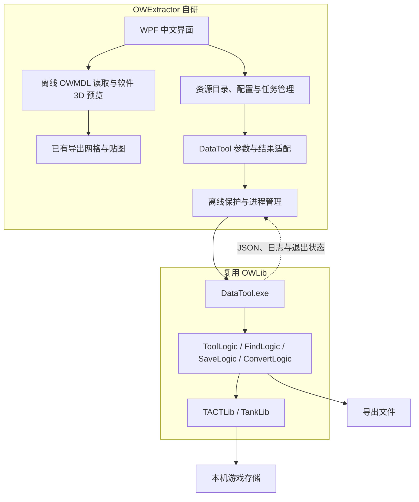

# OWExtractor

基于 [OWLib / DataTool](https://github.com/overtools/OWLib) 的中文守望先锋资源提取桌面客户端。

浏览英雄与皮肤、查看既有导出结果、管理提取任务，通过图形界面调用 DataTool。

> **当前为 v0.4.0 开发预览。** 浅色素材库统一了字体与控件，预览随窗口伸缩，资源详情与导出选项独立切换。可读取旧导出的 OWMDL 网格与颜色贴图，进行真正的 3D 旋转、缩放和平移。离线预览与交互已通过本地检查；游戏目录读取与真实提取尚待退出游戏后验收。


## 当前功能

- 中文 Windows 桌面界面。
- 导入之前保存的 DataTool 英雄 JSON，按资源 GUID 合并中文名称。
- 导入 `list-unlocks` JSON，支持扁平及嵌套结构。
- 导入既有 `Heroes/英雄/Skin/分类/皮肤` 导出目录，统计模型及文件数量。
- 搜索英雄、筛选皮肤、多选并加入任务队列。
- 浅色素材库、分类导航与皮肤资源卡片；搜索按 Enter 或点击“搜索”后显示结果，返回时保留筛选。
- 关联旧导出的 `.owmdl` 模型，拖动旋转、滚轮缩放、右键平移；支持正面 / 背面、复位与窗口内展开。
- 保留原有正面 / 背面缓存图，未关联模型或模型载入失败时可继续查看。
- 自有资源方块与提取箭头图标，覆盖标题栏、可执行文件与侧栏。
- 按文件类型统计模型、材质、贴图、动画和声音；旧缓存没有细分统计时明确提示。
- 选择任务是否包含贴图、动画、音效；基础模型、材质与装配依赖保留。
- 导入历史声音统计 JSON，分中文、英文和关联音效浏览。
- 打开已有结果目录；队列和日志放在独立页面。
- 保存目录缓存、设置与任务记录。
- 提取进程管理、逐个执行、取消和重试的基础实现。
- 所选资源详情、仅已有结果筛选、无结果提示及上下文操作。
- 统一的 14 号正文、12 号说明、16 号区块标题和 28 号页面标题；资源详情 / 导出选项独立切换，队列操作固定在详情栏底部。
- 独立设置页面、紧凑窗口布局与键盘快捷操作；提取路径与引擎配置收进“提取设置”。

**动画播放、完整 PBR 材质、实体与武器自动装配、音频文件试听、音乐 / 地图 / 图像的文件浏览与提取、自动下载引擎暂未提供。** 分类入口已预留，未接入的页面明确说明当前状态。现有模型可使用上游 [io_scene_owm](https://github.com/overtools/io_scene_owm) 插件导入 Blender。

## 下载与运行

在本仓库 Releases 获取 Windows x64 便携预览包，解压后运行 `OWExtractor.exe`。

自包含便携包无需另外安装 .NET。软件本身及 DataTool 均无需以管理员身份运行。

DataTool 由用户单独准备，本项目的下载包不附带游戏资源或第三方提取引擎。

## 游戏运行时：使用离线模式

每次启动都默认进入离线模式。“允许读取游戏”不会跨启动保存。

离线模式下可以：

1. 在“导入资源”菜单中选择“英雄列表（历史 JSON）”，导入之前 `list-heroes --json` 保存的文件。
2. 如有对应中文快照，在同一菜单中选择“合并中文英雄名称（JSON）”。
3. 导入之前保存的皮肤 JSON，或选择“已有模型导出目录”。
4. 在“模型与皮肤”选择英雄，查看文件统计；展开“当前模型信息”后点击“更换本地模型”，或通过“导入资源”关联旧模型和预览图。
5. 将所选皮肤及内容选项加入队列；声音统计可单独导入历史 JSON。

离线队列只保存待执行记录，不启动 DataTool。导入目录只接受既有导出结构，不接受游戏安装目录。

使用 `--offline` 启动会锁定本次会话的游戏读取开关；`--no-activate` 可在打开窗口时保留当前应用焦点。默认采用 WPF 软件渲染，不启动 Blender；`--software` 可在本次启动中强制保持软件模式。3D 仅随输入更新，没有自动旋转或常驻后台渲染循环；`--offline` 启动时本程序使用较低进程优先级。游戏资源、个人配置与缓存图片均不包含在仓库中。

3D 预览只展示所选模型文件的静态初始网格，并读取该导出目录内引用的基础颜色贴图。支持 OWMDL 2.0 / OWMAT 3.0；缺失材质使用默认色并显示数量。为了控制负担，单模型上限为 20 万顶点、30 万三角面，贴图最多 32 张、预览解码最长边 512 像素。游戏路径、网络路径、目录链接及超出导出范围的引用会被拒绝。

材质预览区分颜色、透明遮罩和眼睛的打包数据。OW2 头发使用第二套 UV 读取透明遮罩，加载时生成可见边缘网格；缩小贴图前保留独立颜色通道。玻璃与折射表面使用简化高光，仍不等同于游戏内完整材质。

| 操作 | 方式 |
| --- | --- |
| 旋转 | 左键拖动；模型区聚焦后使用方向键 |
| 缩放 | 滚轮；工具栏或键盘 `+` / `−` |
| 平移 | 右键 / 中键拖动，或 Shift + 左键 |
| 适应窗口 | 工具栏“适应” / `F`，保留视角并恢复缩放和平移 |
| 复位 | 双击模型 / `Home`，恢复初始视角 |
| 展开与返回 | 展开按钮；收起按钮 / `Esc`；保留当前视角 |

在“设置 → 3D 预览”选择渲染模式，保存后下次启动生效：默认软件渲染在拖动/滚轮交互期间采用轻量网格与较低分辨率，松手或滚轮停止后恢复完整模型；“硬件优先”允许 WPF 在硬件可用时加速，不支持时由 WPF 回退。目标帧率可选 30 / 60 FPS，并不保证实际达到该速率。硬件模式仍保持离线，可能与运行中的游戏共享显卡资源。

在设置中开启“显示性能信息”，可查看交互帧提交速率和软件绘制耗时，不将其当作显示器呈现帧率或 GPU 计时。所有 `--render`、`--verify-ui` 与 `--benchmark-preview` 检查均强制软件模式，保存的硬件偏好不会覆盖该限制。GPU 路径已接入，但本轮没有启动或实测 GPU 渲染。

没有皮肤 JSON 时，目录只展示已导入的旧皮肤；它不代表完整的游戏皮肤列表。

## 游戏退出后：提取资源

> 此流程已有代码实现，尚未完成本机真实提取验收。请先验证一个皮肤，再使用批量任务。

1. 退出守望先锋，准备与游戏版本兼容的 DataTool。
2. 普通启动客户端，打开侧栏“设置”，设置 `DataTool.exe`、游戏目录、导出目录和资源语言。通过 `--offline` 启动的会话需要退出后普通启动，才能启用游戏读取。
3. 勾选“允许读取游戏”。启动引擎前仍会检查游戏进程名称。
4. 点击“从游戏刷新目录”，取得当前资源语言对应的英雄和皮肤名称。
5. 保存并返回资源库，选择皮肤和资源内容，加入队列，再进入“提取队列”点击“开始提取”。
6. 查看任务状态及日志，通过 Blender 插件核对模型与材质。

资源语言应与英雄、皮肤列表的原始名称一致。仅合并中文名称不会更改用于查询的原始名称。切换资源语言后，应重新刷新目录并重建待执行任务。

每次执行使用新的任务子目录，取消后的部分文件会保留。客户端以进程结果及非空模型文件做基础检查；“已完成”不代表模型、材质与动画已经逐项验证。

## 架构与上游分工



中文界面、目录缓存、任务队列、离线导出格式读取与 3D 预览、进程适配由本项目开发；游戏存储读取、游戏资源格式解析、依赖追踪及导出由上游实现。离线读取器参考 io_scene_owm 的公开导出格式。

详见 [架构说明](docs/architecture.md) 和 [验证记录](docs/validation.md)。

界面改进参考 Damir Sokolovsky 的 [unslop](https://github.com/heydamir/unslop) 方法，具体调整与验证见 [UI/UX 说明](docs/uiux.md)。

## 本地开发

需要 Windows、.NET 10 SDK。项目没有额外 NuGet 包依赖。

```powershell
dotnet build OWExtractor.slnx -c Release -m:1
dotnet run --project tests/OWExtractor.Tests -c Release
dotnet run --project src/OWExtractor.App
```

测试使用合成数据和测试程序自身创建的子进程，不运行 DataTool，不读取游戏文件。

生成自包含 Windows x64 便携包：

```powershell
dotnet publish src/OWExtractor.App -c Release -r win-x64 --self-contained true -o artifacts/win-x64 -m:1
pwsh ./scripts/package-release.ps1 -PublishDirectory ./artifacts/win-x64 -ZipPath ./artifacts/OWExtractor-win-x64.zip
```

发布脚本会收集实际 .NET / Windows Desktop 版本的许可证与第三方说明，排除调试符号，检查个人配置和游戏资源，并生成 SHA-256 文件。Desktop 运行时包未附带的 WPF 和 Windows Forms 第三方说明从其对应发布标签下载；缺少匹配声明时不会生成发布包。

发布说明见 [v0.4.0-preview.1](docs/releases/v0.4.0-preview.1.md)。版本标签只在源码与 CI 检查完成后推送，GitHub Actions 会生成预发布。

配置默认保存在 `%LOCALAPPDATA%/OWExtractor/settings.json`；也可以用 `--profile <文件路径>` 指定独立配置。不要将本地配置或提取资源提交到 Git。

## 开发路线

- [x] 项目分层与 DataTool 进程适配。
- [x] 中文界面、旧目录导入、搜索和队列持久化。
- [x] 浅色素材库、静态缓存图片大预览及历史声音统计。
- [x] 离线保护、参数传递、取消与错误解析测试。
- [ ] 游戏退出后的真实目录刷新与单皮肤提取验收。
- [ ] 当前游戏版本与上游引擎的兼容性验证。
- [ ] 缓存版本自动失效、中文皮肤名称映射。
- [ ] 批量真实提取与 Blender 导入回归。
- [x] 内置静态模型与基础颜色贴图预览、自有应用图标。
- [ ] 完整材质、实体装配与动画预览。
- [ ] 地图等更多资源类型。

## 问题反馈

请在 Issues 提供客户端版本、DataTool 版本、资源语言、复现步骤和相关日志。提交前移除不希望公开的本地路径等信息。

## 许可证与致谢

本项目使用 [MIT 许可证](LICENSE)。

感谢 [overtools/OWLib](https://github.com/overtools/OWLib) 及其贡献者提供资源提取能力，感谢 [overtools/io_scene_owm](https://github.com/overtools/io_scene_owm) 提供 Blender 导入插件。第三方说明见 [THIRD_PARTY_NOTICES.md](THIRD_PARTY_NOTICES.md)。

本项目是独立社区工具，与 Blizzard Entertainment 无关联。游戏内容及相关商标属于各自权利人。
