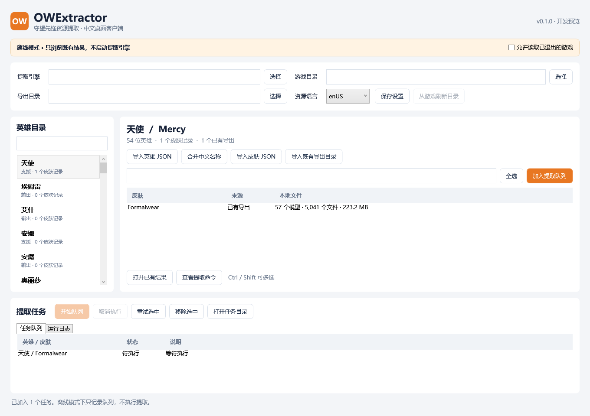
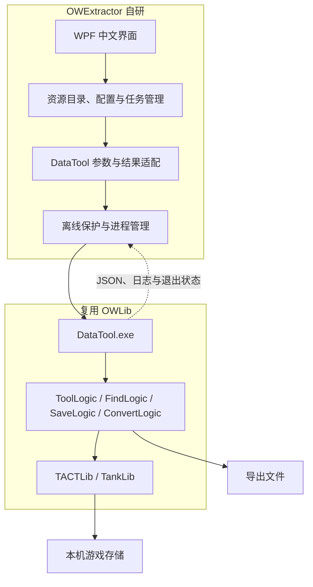

# OWExtractor

基于 [OWLib / DataTool](https://github.com/overtools/OWLib) 的中文守望先锋资源提取桌面客户端。

浏览英雄与皮肤、查看既有导出结果、管理提取任务，通过图形界面调用 DataTool。

> **当前为 v0.1.0 开发预览。** 已验证离线浏览和客户端基础流程；游戏目录读取与真实提取尚待退出游戏后验收。内置 3D 预览尚未实现。



## 当前功能

- 中文 Windows 桌面界面。
- 导入之前保存的 DataTool 英雄 JSON，按资源 GUID 合并中文名称。
- 导入 `list-unlocks` JSON，支持扁平及嵌套结构。
- 导入既有 `Heroes/英雄/Skin/分类/皮肤` 导出目录，统计模型及文件数量。
- 搜索英雄、筛选皮肤、多选并加入任务队列。
- 查看提取命令、打开已有结果目录。
- 保存目录缓存、设置与任务记录。
- 提取进程管理、逐个执行、取消和重试的基础实现。

**内置 3D 预览、地图浏览、自动下载引擎暂未提供。** 现有模型可使用上游 [io_scene_owm](https://github.com/overtools/io_scene_owm) 插件导入 Blender。

## 下载与运行

在本仓库 Releases 获取 Windows x64 便携预览包，解压后运行 `OWExtractor.exe`。

自包含便携包无需另外安装 .NET。软件本身及 DataTool 均无需以管理员身份运行。

DataTool 由用户单独准备，本项目的下载包不附带游戏资源或第三方提取引擎。

## 游戏运行时：使用离线模式

每次启动都默认进入离线模式。“允许读取已退出的游戏”不会跨启动保存。

离线模式下可以：

1. 点击“导入英雄 JSON”，选择之前 `list-heroes --json` 保存的文件。
2. 如有对应中文快照，点击“合并中文名称”。
3. 导入之前保存的皮肤 JSON，或点击“导入既有导出目录”。
4. 选择英雄、搜索皮肤、查看文件统计和已有结果。
5. 将所选皮肤加入队列，或查看生成的命令。

离线队列只保存待执行记录，不启动 DataTool。导入目录只接受既有导出结构，不接受游戏安装目录。

没有皮肤 JSON 时，目录只展示已导入的旧皮肤；它不代表完整的游戏皮肤列表。

## 游戏退出后：提取资源

> 此流程已有代码实现，尚未完成本机真实提取验收。请先验证一个皮肤，再使用批量任务。

1. 退出守望先锋，准备与游戏版本兼容的 DataTool。
2. 设置 `DataTool.exe`、游戏目录、导出目录和资源语言。
3. 勾选“允许读取已退出的游戏”。启动引擎前仍会检查游戏进程名称。
4. 点击“从游戏刷新目录”，取得当前资源语言对应的英雄和皮肤名称。
5. 选择皮肤，加入队列，开始执行。
6. 查看任务状态及日志，通过 Blender 插件核对模型与材质。

资源语言应与英雄、皮肤列表的原始名称一致。仅合并中文名称不会更改用于查询的原始名称。切换资源语言后，应重新刷新目录并重建待执行任务。

每次执行使用新的任务子目录，取消后的部分文件会保留。客户端以进程结果及非空模型文件做基础检查；“已完成”不代表模型、材质与动画已经逐项验证。

## 架构与上游分工



中文界面、目录缓存、任务队列及进程适配由本项目开发；游戏存储读取、资源格式解析、依赖追踪及导出由上游实现。

详见 [架构说明](docs/architecture.md) 和 [验证记录](docs/validation.md)。

## 本地开发

需要 Windows、.NET 10 SDK。项目没有额外 NuGet 包依赖。

```powershell
dotnet build OWExtractor.slnx -c Release -m:1
dotnet run --project tests/OWExtractor.Tests -c Release
dotnet run --project src/OWExtractor.App
```

测试使用合成数据和测试程序自身创建的子进程，不运行 DataTool，不读取游戏文件。

生成自包含 Windows x64 便携包：

```powershell
dotnet publish src/OWExtractor.App -c Release -r win-x64 --self-contained true -o artifacts/win-x64 -m:1
```

配置默认保存在 `%LOCALAPPDATA%/OWExtractor/settings.json`；也可以用 `--profile <文件路径>` 指定独立配置。不要将本地配置或提取资源提交到 Git。

## 开发路线

- [x] 项目分层与 DataTool 进程适配。
- [x] 中文界面、旧目录导入、搜索和队列持久化。
- [x] 离线保护、参数传递、取消与错误解析测试。
- [ ] 游戏退出后的真实目录刷新与单皮肤提取验收。
- [ ] 当前游戏版本与上游引擎的兼容性验证。
- [ ] 缓存版本自动失效、中文皮肤名称映射。
- [ ] 批量真实提取与 Blender 导入回归。
- [ ] 内置模型、材质与动画预览。
- [ ] 地图等更多资源类型。

## 问题反馈

请在 Issues 提供客户端版本、DataTool 版本、资源语言、复现步骤和相关日志。提交前移除不希望公开的本地路径等信息。

## 许可证与致谢

本项目使用 [MIT 许可证](LICENSE)。

感谢 [overtools/OWLib](https://github.com/overtools/OWLib) 及其贡献者提供资源提取能力，感谢 [overtools/io_scene_owm](https://github.com/overtools/io_scene_owm) 提供 Blender 导入插件。第三方说明见 [THIRD_PARTY_NOTICES.md](THIRD_PARTY_NOTICES.md)。

本项目是独立社区工具，与 Blizzard Entertainment 无关联。游戏内容及相关商标属于各自权利人。
